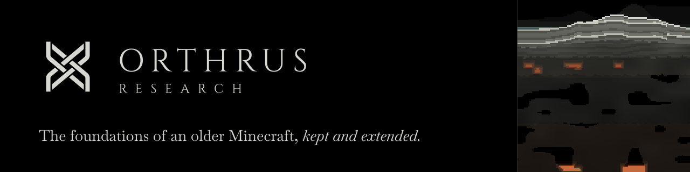

Orthrus Research maintains and extends the technical foundations of Minecraft 1.12.2, for the
players who build on them and the programmers who keep them running.

In myth, Orthrus kept watch over a herd. The name stands for that kind of work: keeping a
platform in good repair long after most of the world moved on. *For you, with love.*

## Projects

- **[Riven](https://github.com/orthrus-research/Riven)** · terrain. Deterministic terrain for cubic
  worlds: continents, climate, landforms, water and geology from one seed, shared by the world and
  its Distant Horizons view. [Research preview](https://orthrus.cc/projects/riven).
- **[Cubature](https://github.com/orthrus-research/Cubature)** · cubic worlds. A maintained fork of
  CubicChunks: cubic-world scheduling, lighting, storage and delivery.
  [Research preview](https://orthrus.cc/projects/cubature).
- **[GTCEu: Reloaded](https://github.com/orthrus-research/GTCEu-Reloaded)** · machines. A continuation
  of GregTech CE Unofficial, with selected features from GregTech CEu: Modern and GregTech: New
  Horizons. [In development](https://orthrus.cc/projects/gtceu-reloaded).
- **OrthLib** · contracts. Shared presentation, validation and lifecycle contracts for mods on
  Cleanroom. [Forthcoming](https://orthrus.cc/projects/orthlib).
- **[Quadrature](https://github.com/orthrus-research/Quadrature)** · rendering. A rendering pipeline
  for cubic worlds on Cleanroom with Cubature: near terrain meshed from cubes, distant terrain and
  its own shading. In development.

## Tools

- **[Workbench Reloaded](https://github.com/orthrus-research/WorkbenchReloaded)** · developer tools.
  Tooling for Minecraft developers behind one terse local API: CI, game sessions, captures and
  comparisons. In development.

## On orthrus.cc

- [Projects](https://orthrus.cc/projects): what each project is, what it needs and where it stands.
- [Texts](https://orthrus.cc/texts): guides, research and updates, also as an
  [Atom feed](https://orthrus.cc/texts/feed.xml).
- [The record](https://orthrus.cc/record): every timed run of the test harness, passed or failed.
- [About](https://orthrus.cc/about): who Orthrus Research is, how every change is verified, and how
  to contribute or report a problem.

## Contact

- Questions and discussion: [Discord](https://discord.gg/qCVqhXtSzR)
- Bugs and requests: the issues of the repository concerned
- Security and private matters: admin@orthrus.cc

## How the work is done

Every change is verified before it lands, and each repository's `CONTRIBUTING.md` names its
checks. Orthrus Research develops with AI assistance (Claude Code and Codex) and holds every change
to the same gates whatever its origin; see [AI usage](https://github.com/orthrus-research/.github/blob/main/AI.md).
Pull requests are welcome; see [contributing](https://github.com/orthrus-research/.github/blob/main/CONTRIBUTING.md)
and the [code of conduct](https://github.com/orthrus-research/.github/blob/main/CODE_OF_CONDUCT.md).
